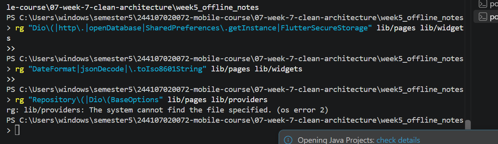
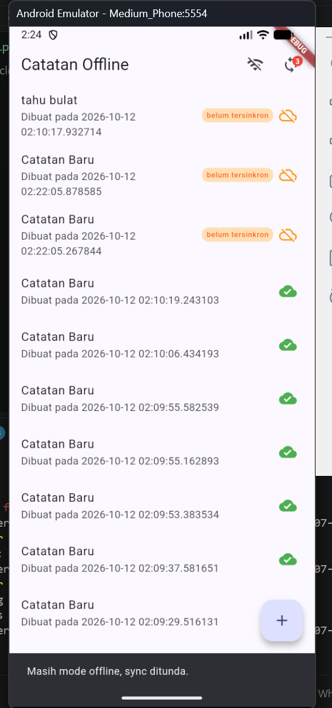
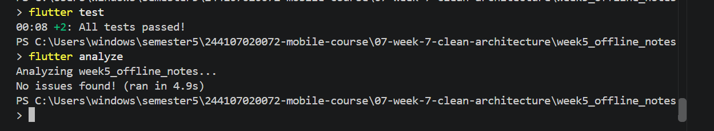

# petakan file ke layer
1. data/local/note.dart	data | entity dan model tercampur | (toMap/fromMap di entity)
2. data/repositories/note_repository.dart | data | tidak ada interface, langsung memakai sqflite
3. data/sync.dart | data | logika bisnis tercampur dengan SQL dan jsonDecode
4.  data/providers.dart | presentation | satu file berisi DI, notifier, helper test, dan DioException
5. data/prefs.dart	data | tidak | ada kontrak (interface)
6. pages/notes_page.dart | presentation | setState manual dan memanggil sync.dart langsung
7. pages/note_detail_page.dart | presentation | setState manual untuk load data

### foto audit before

# tugas ai challenge

# refactoring + tugas akhir week 7
### berhasil sinkron

### tidak berhasil sinkron

### melihat dan mengedit

### hasil test analyze dan test

# refleksi
1. Mengapa interface repository harus tinggal di domain, bukan di data? Apa yang rusak bila dibalik?  
Interface adalah kebutuhan domain: ia mendefinisikan apa yang diperlukan logika bisnis (misalnya fetchNotes()), bukan bagaimana data diambil. Kalau interface tinggal di data, GetNotes harus meng-import file dari layer data, dan panah dependensi berbalik menjadi domain → data. Akibatnya:
Domain ikut bergantung pada detail teknis seperti sqflite dan Dio. Grep sterilitas gagal.
Use case tidak bisa diuji tanpa database, karena fake repository ikut menyeret package data.
Mengganti SQLite dengan sumber lain memaksa perubahan di domain, padahal aturan bisnisnya sama. 
2. Kapan use case benar-benar dibutuhkan, dan kapan repository langsung ke notifier sudah cukup? 
Use case dibutuhkan ketika sebuah operasi punya aturan bisnis atau mengorkestrasi lebih dari satu langkah: validasi, sorting, penggabungan beberapa repository, atau keputusan berbasis kondisi. Di projectku, GetPosts layak jadi use case karena ia memutuskan antara mode offline (hanya baca cache) dan cache-first dengan refresh di background. Aturan itu bisa diuji murni dengan repository palsu.
Repository langsung ke notifier atau UI sudah cukup untuk CRUD satu baris yang hanya meneruskan panggilan. Contoh: addNote, deleteNote, dan updateNote di fitur notes, serta seluruh fitur settings (baca/tulis dark mode). Use case di sana hanya membungkus satu pemanggilan tanpa menambah nilai. 
3. Apa biaya over-engineering (use case per CRUD satu-baris) bagi tim kecil? Kapan biayanya sepadan? 
Biayanya:

Satu file dan satu provider tambahan per operasi, tanpa logika di dalamnya.
Lebih banyak file untuk dibuka dan di-review saat debugging.
Onboarding lebih lambat, dan perubahan kecil menyentuh banyak file.
Test yang hanya memverifikasi bahwa “use case memanggil repository” tidak menangkap bug apa pun.

Bagi tim kecil, biaya ini lebih besar daripada manfaatnya selama logikanya tipis. Biayanya sepadan ketika:

operasi mulai punya aturan bisnis (validasi, sync, resolusi konflik);
beberapa layar atau fitur memakai logika yang sama dan perlu satu sumber kebenaran;
tim bertambah sehingga kontrak yang jelas mencegah tabrakan;
logika perlu diuji terisolasi.

Karena itu addNote bisa dinaikkan jadi use case kalau nanti ditambah validasi judul kosong atau batas panjang. 
4. Bagian mana dari usulan AI yang Anda tolak atau sederhanakan, dan mengapa? 
Use case per CRUD (ditolak): AI mengusulkan AddNote, UpdateNote, DeleteNote, dan semacamnya. Kusederhanakan menjadi satu use case GetNotes dan GetPosts, sedangkan operasi lain langsung lewat repository, karena tidak ada aturan bisnis di dalamnya.
Use case dan entity untuk settings (ditolak): hanya membaca dan menulis preferensi. Kuberi interface repository saja supaya DI tetap konsisten.
Record Result<T> generik (disederhanakan): daripada satu record berbeda per method, satu typedef dipakai ulang agar tidak duplikat. Tidak memakai fpdart karena menambah dependensi baru.
lib/shared/ untuk DB dan Dio (keputusan sendiri): db.dart dan api_client.dart dipakai dua fitur dan memakai sqflite/Dio, jadi tidak boleh di lib/core yang harus steril dari package.
Yang kuterima: struktur feature-first dan interface di domain dengan implementasi di data. Keduanya terbukti lolos grep sterilitas.