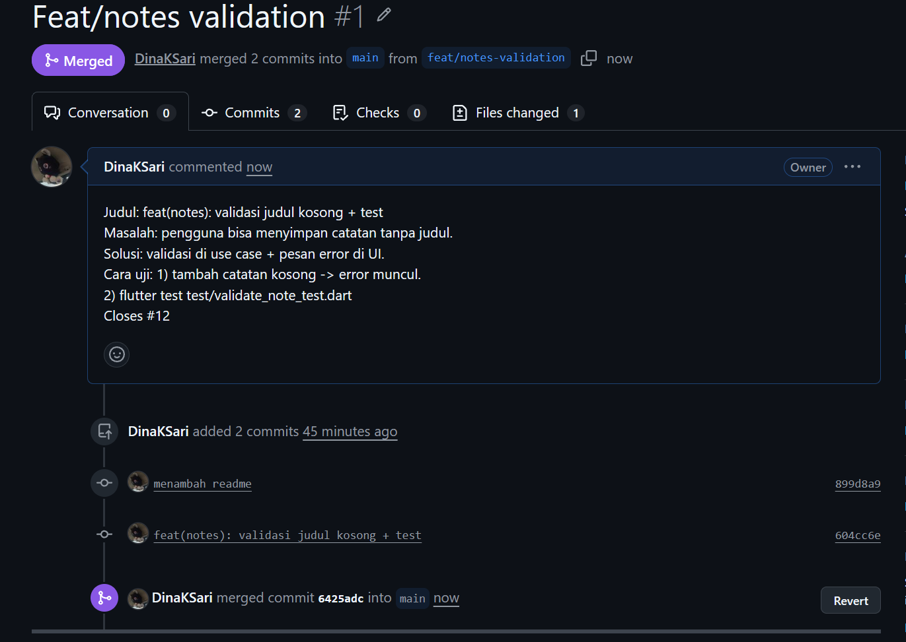
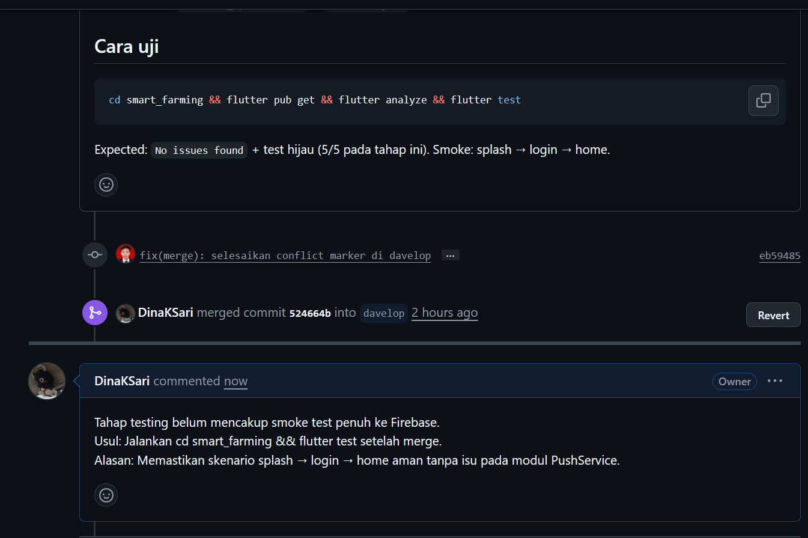
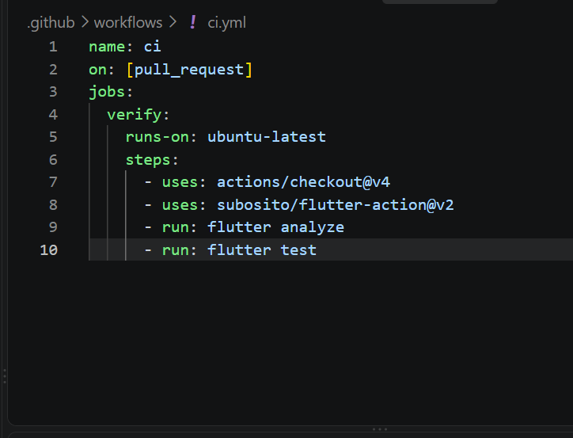

# praktikum 1

# praktikum 2

# praktikum 3

# refleksi
1. Apa beda LGTM buta dengan approve yang bertanggung jawab? Apa risikonya bagi tim?
LGTM Buta: Menyetujui PR asal-asalan tanpa membaca kode.
Risiko: Bug lolos ke production, kualitas kode menurun, dan akuntabilitas tim hilang saat terjadi error.
Approve Bertanggung Jawab: Meninjau kode secara mendalam (logika, tes, dan standar).
Manfaat: Menjaga stabilitas aplikasi, mencegah bug, dan sarana transfer ilmu antar anggota tim.
2. Kapan komentar wajib berstatus request changes, dan kapan cukup saran?
Wajib Request Changes: Untuk masalah kritis yang tidak boleh masuk ke develop/main (ada bug fatal, celah keamanan, logika salah, atau tes gagal/merah).
Cukup Saran / Komentar Biasa: Untuk peningkatan minor yang tidak menghentikan fungsi utama (gaya penulisan, penamaan variabel, atau usulan kerapian kode).
3. Bagian mana dari review AI yang Anda tolak atau sederhanakan, dan mengapa? 
saya sederhanakan karena agar lebih ringkas dan mudah dipahami.
4. Satu hal konkret yang Anda perbaiki setelah review sejawat — apa dampaknya?
saya perbaiki cara penulisan pull request saya, jadi lebih bagus. dampaknya, mudah dibaca dan point nya cepat dapat.