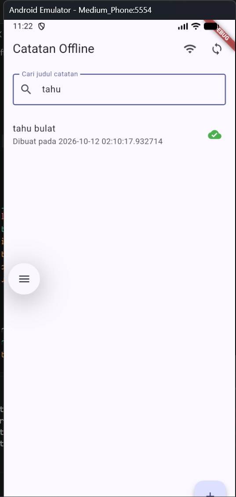
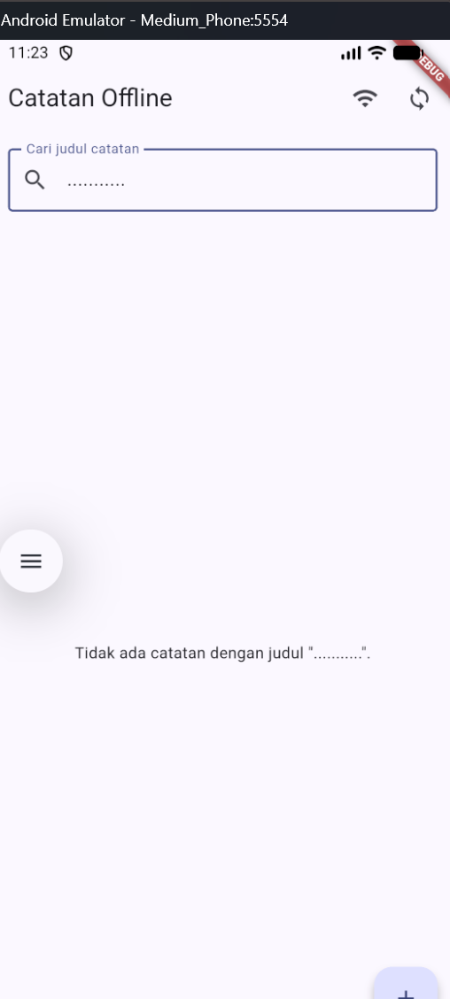

# Praktikum 1
Pencarian judul catatan selesai dengan filter di repository data, alurnya melewati use case dan kontrak domain. Binding implementasi repository dipindahkan ke shared providers; widget tidak mengakses SQLite.

Ditambahkan empty state khusus saat pencarian tidak menemukan catatan serta satu widget test. Semua 3 test lulus dan tidak ada error analisis. Hot reload tidak dilakukan karena tidak ada aplikasi Flutter yang sedang terhubung.  

# Praktikum 2
### search sukses

### search gagal

# praktikum 3
### hasil test dan analyze

# refleksi
1. Saya tidak menemukan halusinasi AI yang bisa saya buktikan pada implementasi ini. Saya memeriksa alur pencarian dari kontrak repository sampai query SQLite dan menjalankan test; ketiganya lulus. Namun, test baru adalah widget test dengan repository fake, jadi perilaku query SQLite belum diuji langsung.
2. Prompt awal yang paling membantu karena menyebut fitur, batas arsitektur, empty state, dan satu widget test secara spesifik. Saya tidak mengubah prompt tersebut.
3. Saya memindahkan binding `noteRepositoryProvider` dari provider presentation ke `shared/providers.dart`. Dengan begitu, presentation memakai abstraksi domain tanpa mengimpor implementasi data.
4. Keputusan tersulit adalah menjalankan pencarian di repository data, bukan memfilter daftar di widget. Saya memilih query judul di sana supaya pemisahan presentation–domain–data tetap terjaga; parameter pencarian dikirim sebagai argumen query, bukan digabung sebagai SQL.