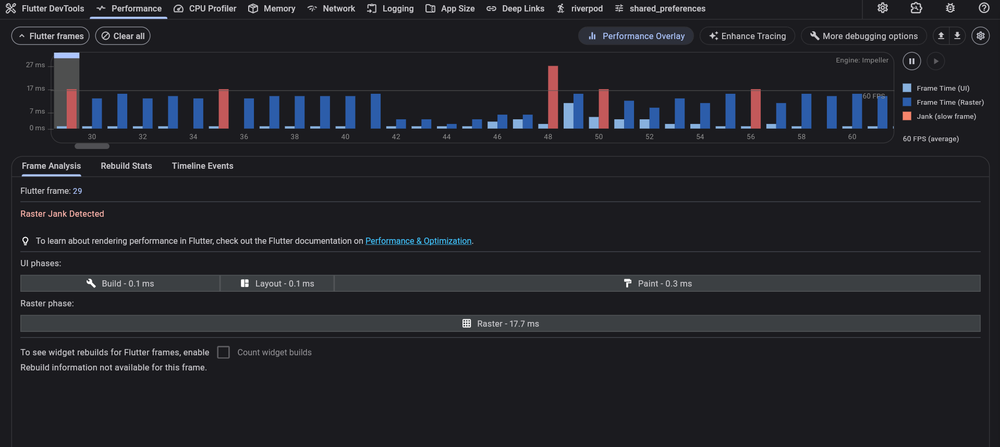
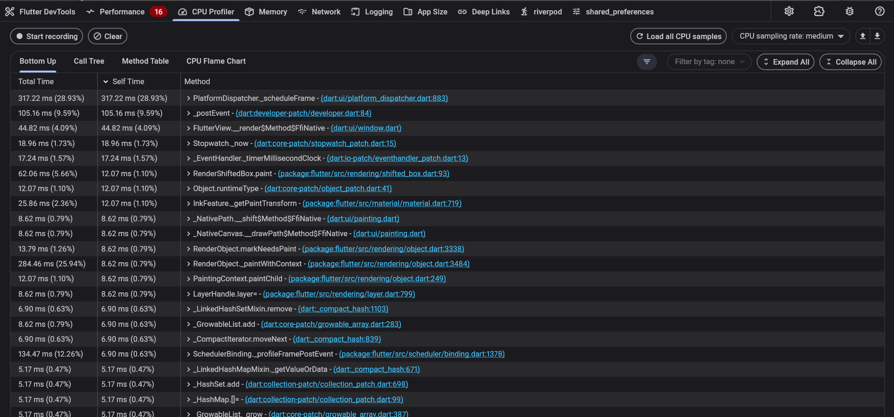
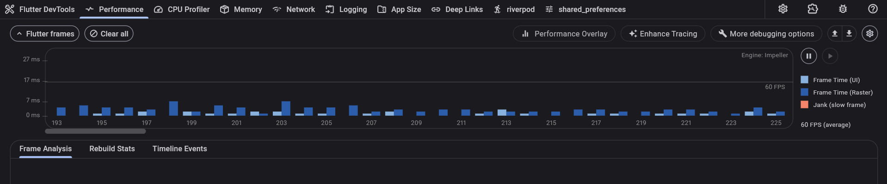
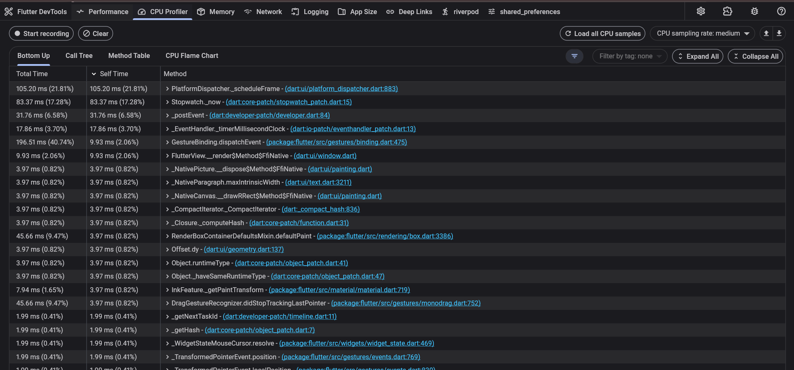
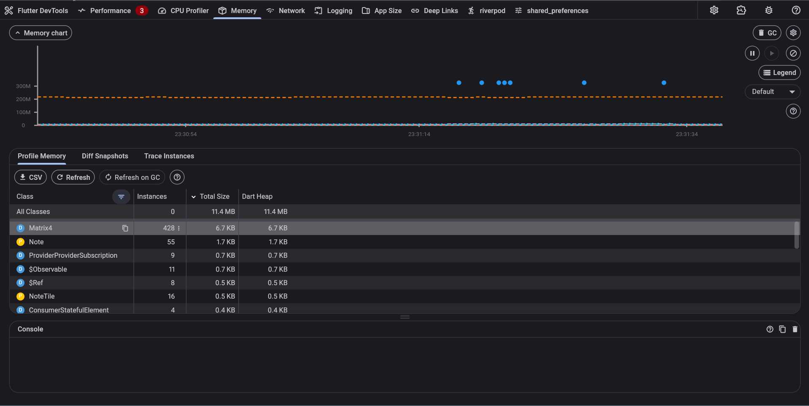
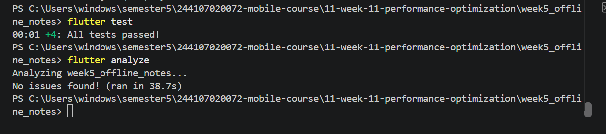

# Hasil Profile Before
## Performance

## CPU

# Hasil Profile After
## Performance

## CPU

## Heap Snapshot tidak ada memori leak

# Hasil flutter test dan analyze

# Refleksi
1. Optimasi mana yang memberikan dampak terbesar dan mengapa? 
cache stale-while-revalidate mengurangi request API yang berulang dan menampilkan data cache lebih cepat. Dibanding optimasi widget, dampaknya bisa lebih terasa saat jaringan lambat. 

2. Bagaimana Anda memverifikasi bahwa optimasi benar-benar bekerja (bukan placebo)? 
test memeriksa cache segar tidak memicu refresh dan refresh latar belakang tidak berulang; analisis dan build juga lolos. Belum ada profil sebelum/sesudah, jadi dampak pada waktu frame belum terbukti terukur. 

3. Trade-off apa yang Anda hadapi (misalnya kompleksitas kode vs performa)? 
cache menambah aturan umur data dan penanganan refresh; ekstraksi widget dan select menambah struktur, tetapi membatasi rebuild. ThemeData yang disimpan dan widget statis lebih sederhana. 
4. Kapan sebaiknya optimasi premature dihindari? 
Hindari premature optimization: jangan mengoptimasi berdasarkan dugaan. Ukur dahulu, cari bottleneck yang konsisten, lalu ubah bagian itu dan bandingkan hasilnya.