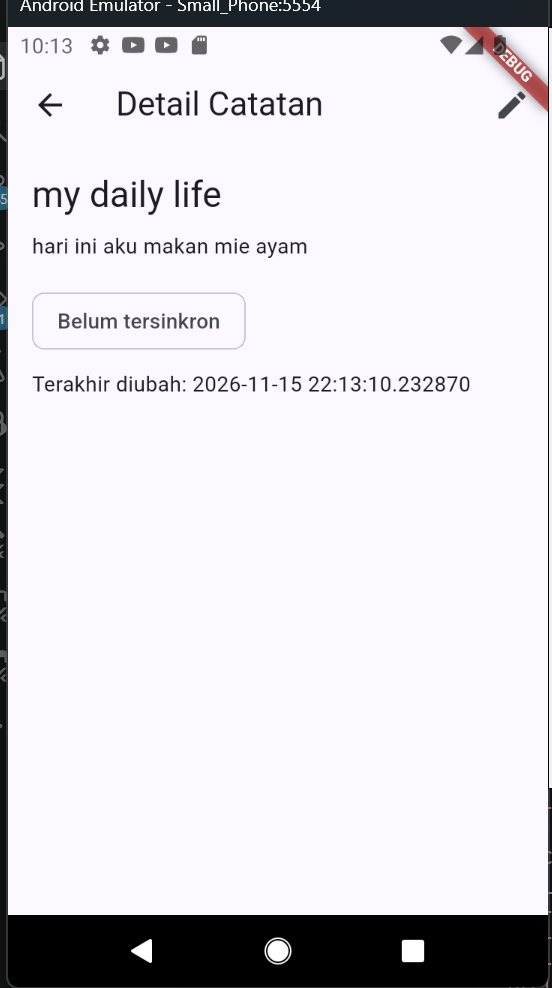
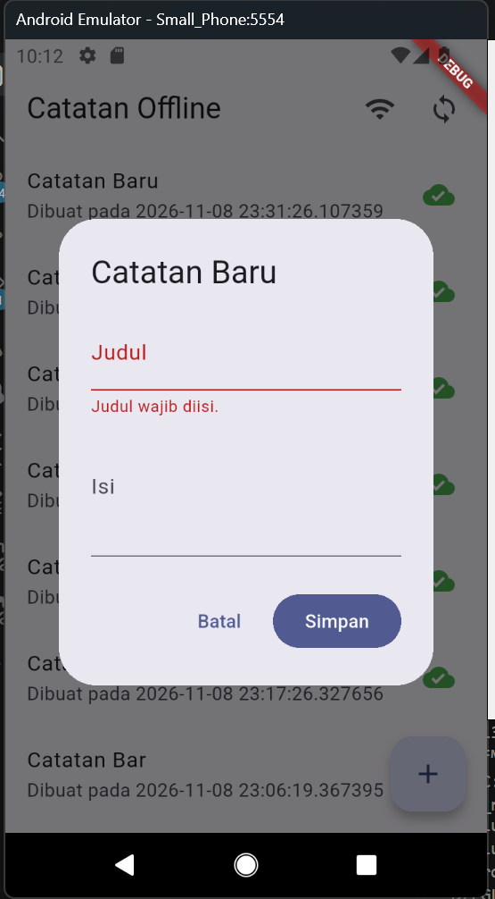

# Skenario pengujian fitur catatan

1. Sukses: pengguna mengisi judul dan isi, menyimpan, lalu melihat catatan di daftar.
  
2. Kasus tepi/input tidak valid: judul kosong atau hanya spasi ditolak dan catatan tidak disimpan.
  
3. Kegagalan dependensi: repository gagal menyimpan; pesan kegagalan ditampilkan dan daftar tidak mendapat catatan baru.
4. Tampilan awal: daftar kosong menampilkan pesan bahwa belum ada catatan.

Pengujian unit memeriksa aturan validasi judul. Pengujian widget memeriksa tampilan,
validasi form, penyimpanan sukses, dan error repository. Pengujian integrasi
memeriksa alur pengguna dari daftar kosong hingga catatan baru tampil.

# Refleksi
1. Bug apa yang paling mungkin terlewat tanpa pengujian yang Anda tulis?
jawab: Judul kosong dapat tersimpan, atau catatan yang gagal disimpan tidak menampilkan pesan error.
2. Bagian mana yang perlu fake, dan bagaimana fake itu membuat pengujian lebih konsisten?
jawab: Repository dan pengaturan aplikasi menggunakan fake agar pengujian tidak bergantung pada database, jaringan, atau data yang berubah-ubah.
3. Apa perbedaan nilai yang diberikan pengujian widget dan pengujian integrasi pada fitur Anda?
jawab: Pengujian widget memeriksa tampilan dan interaksi form. Pengujian integrasi memastikan alur pengguna dari daftar kosong hingga catatan muncul berjalan utuh.