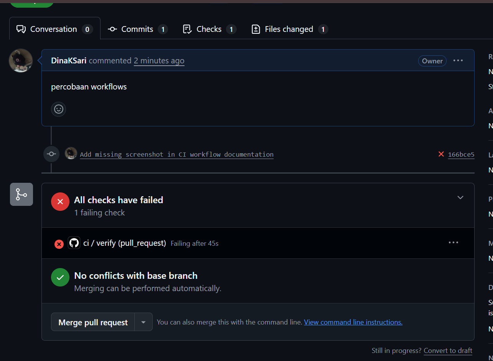
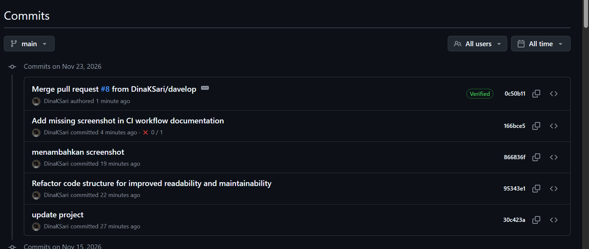

# Tugas
Tambahkan workflow CI ke project Flutter Anda dengan format, analisis, dan test.
Bangun APK dan AAB serta simpan keduanya sebagai artefak.
  
Jalankan workflow melalui pull request atau push ke branch utama; sertakan bukti hasil serta commit. 
 

# Refleksi
Masalah apa yang ditemukan otomatis sebelum perubahan di-merge?
jawab: saat pull request, pada flutter analyze dia gagal padahal jika saya lakukan manual di terminal tidak terdapat masalah dan semua test nya berhasil
Informasi apa yang Anda butuhkan untuk menyelidiki build yang gagal?
jawab: kode yang gagal, tempat file
Bagian mana yang masih perlu persetujuan atau pemeriksaan manual sebelum rilis?
jawab: flutter analyze dan flutter test nya, karena saat pemeriksaan manual berhasil sedangkan dari workflow github malah gagal.